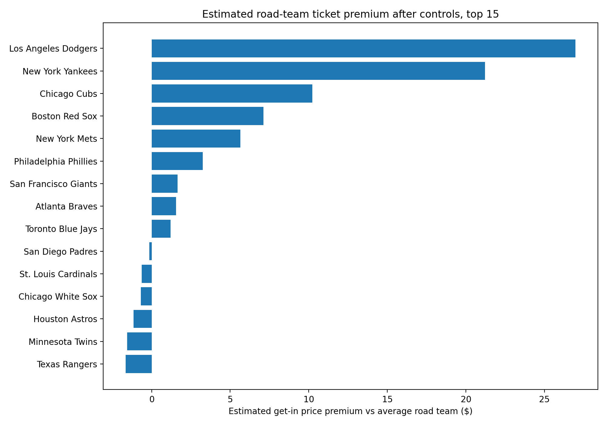
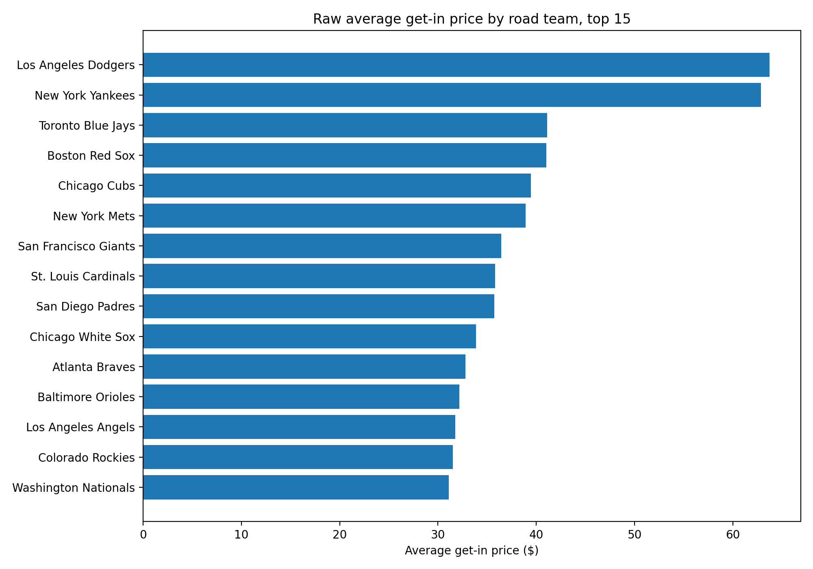
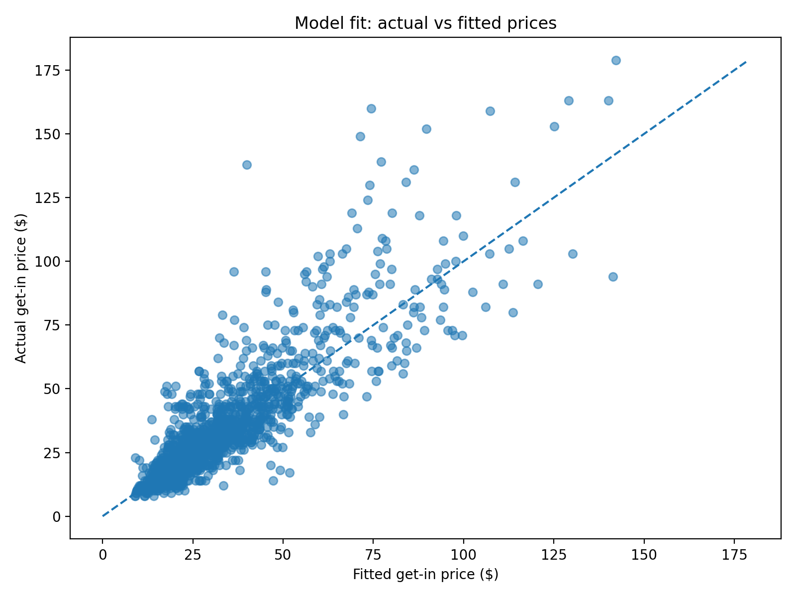

# MLB Road Team Ticket Premium

**Which visiting teams make baseball tickets more expensive, after controlling for the home team and the schedule?**

A fixed-effects regression on 1,600+ get-in (cheapest available) ticket prices for 2026 MLB games that measures how much each road team adds to, or subtracts from, the price of getting into the ballpark.



---

## Key findings

- **The Dodgers and Yankees are the biggest road draws by a wide margin.** With the same home team, month and day of the week, a Dodgers road game costs about **2x** what the average visiting team does (+$27 at the median get-in price). The Yankees add about **+79%** (+$21).
- **After them it drops off fast.** The Cubs (+38%), Red Sox (+26%) and Mets (+21%) form a clear second tier. Most of the league sits within about ±15% of average.
- **Raw averages are misleading.** The Blue Jays have the third-highest raw average get-in price ($41), but after controls their premium is only about +4%. Their road games happen to land in pricey ballparks and on high-demand dates.
- **The schedule matters too.** Monday through Thursday games are about 28–33% cheaper than Friday games, and Saturdays are about 12% more expensive. May was the cheapest month in the sample.
- **The model explains 77% of the variation in log price** (R² = 0.772, n = 1,622 games).

| Road team | Games | Raw avg get-in | Est. premium vs avg road team |
|---|---:|---:|---:|
| Los Angeles Dodgers | 53 | $63.72 | +99.9% (+$26.97) |
| New York Yankees | 53 | $62.87 | +78.6% (+$21.22) |
| Chicago Cubs | 56 | $39.43 | +37.9% (+$10.23) |
| Boston Red Sox | 54 | $41.02 | +26.3% (+$7.11) |
| New York Mets | 52 | $38.90 | +20.9% (+$5.65) |
| … | | | |
| Arizona Diamondbacks | 56 | $29.07 | −18.3% (−$4.95) |
| Athletics | 50 | $25.16 | −18.9% (−$5.11) |

The full results for all 30 teams are in [`outputs/road_team_effects.csv`](outputs/road_team_effects.csv).

## Method

**Data:** get-in prices for 1,626 MLB events from late May to late September 2026. Each row has the matchup, date, venue, city and get-in price. The All-Star Game and All-Star Village events are dropped, which leaves 1,622 regular-season games.

**Model:** OLS on log price with fixed effects:

```
log(price) ~ road_team + home_team + month + day_of_week + weekend
```

- **Log price**, so each coefficient reads as a percentage effect.
- **Home team fixed effects** absorb ballpark, market size and home-team demand. Without them, road teams that visit expensive parks would look like premium draws.
- **Month and day-of-week controls** account for seasonality and weekday-versus-weekend demand.
- **HC3 robust standard errors** handle heteroskedasticity.
- **Centered road-team effects:** each road team's coefficient is measured against the average road team, not an arbitrary team left out of the model. Effects are turned into percentages with `exp(β) − 1`, and into dollars using the median get-in price ($27).

**Caveat:** the `weekend` dummy is collinear with the day-of-week effects, which statsmodels flags as a rank-deficiency warning. This doesn't change the road-team estimates.

## Charts

| Raw average price by road team | Actual vs fitted |
|---|---|
|  |  |

## Repository structure

```
├── road_team_impact.ipynb        # full analysis: cleaning → regression → outputs
├── data/
│   └── mlb_get_in_prices.csv     # raw get-in price data
├── outputs/
│   ├── road_team_effects.csv     # estimated premium for every road team
│   ├── regression_summary.txt    # full statsmodels OLS output
│   └── figures/                  # charts
├── requirements.txt
└── .devcontainer/                # UCSD Rady MSBA Docker environment config
```

## Running it

```bash
pip install -r requirements.txt
jupyter notebook road_team_impact.ipynb
```

Run all cells. The notebook reads `data/mlb_get_in_prices.csv` and rewrites everything in `outputs/`. You can also open the folder in VS Code with the Dev Containers extension to use the `rsm-msba` image.

## Tech stack

Python · pandas · NumPy · statsmodels · matplotlib · Jupyter
